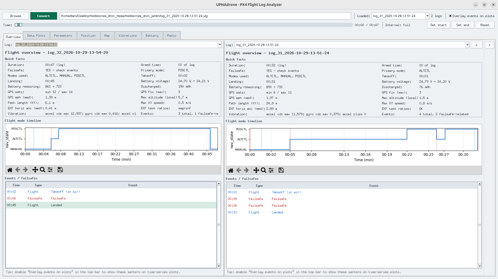
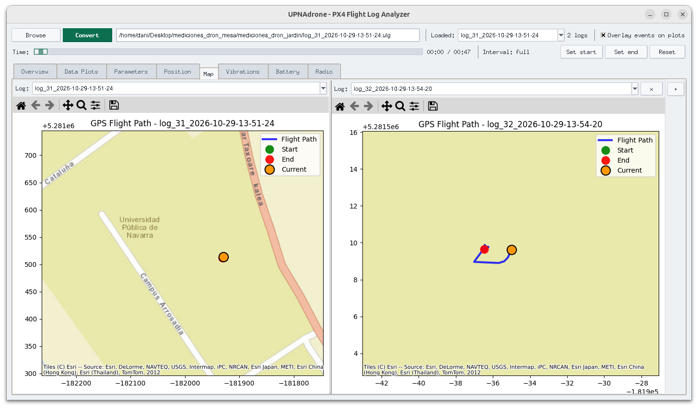
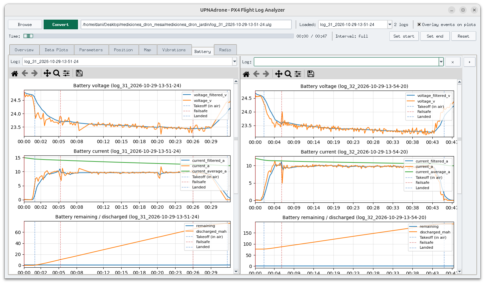
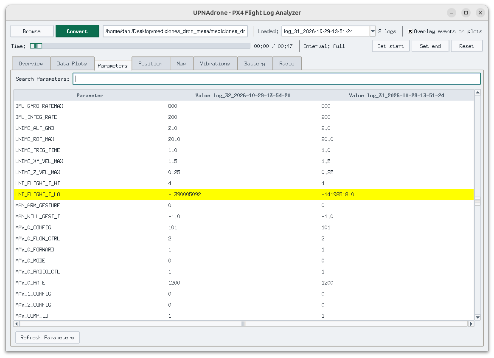

# UPNAdrone Log Viewer

Desktop app to convert and review PX4 **ULog** flight logs: Overview, time-series plots, parameters comparison, GPS map, and a shared time cursor / interval.

Load multiple logs side by side, scrub a global time cursor, and focus on a selected interval across Overview, Map, Battery, and the other analysis tabs.

## Screenshots

### Overview — side-by-side flight summary

Quick facts, mode timeline, and events / failsafes for two flights at once.



### Map — GPS path comparison

Split Map panes with basemap tiles, flight path, and current-position marker synced to the global timeline.



### Battery — curated telemetry with event overlays

Voltage, current, and remaining / discharged plots; optional event markers (takeoff, failsafe, landed).



### Parameters — diff across loaded logs

Searchable parameter table; differing values are highlighted.



---

## Choose how to install

| Who you are | Use |
|-------------|-----|
| Have Python 3.10+ and want the lightest setup | [Run from source](#1-run-from-source) |
| Want a normal Ubuntu app (no Python setup) | [Ubuntu 24 package (`.deb`)](#2-ubuntu-24-packaged-app-deb) |
| Want a Windows installer | [Windows package](#3-windows-packaged-app) |

---

## 1) Run from source

**Requirements:** Python 3.10+, `tkinter` (usually `python3-tk` on Ubuntu), pip.

### Ubuntu / Linux / macOS

```bash
git clone <REPO_URL> upnadrone-log-viewer
cd upnadrone-log-viewer
chmod +x run.sh
./run.sh
```

The first run creates a local `.venv` and installs `requirements.txt`.

### Windows

```bat
git clone <REPO_URL> upnadrone-log-viewer
cd upnadrone-log-viewer
run.bat
```

Or double-click `run.bat`.

### Manual setup

```bash
python3 -m venv .venv
source .venv/bin/activate          # Windows: .venv\Scripts\activate
pip install -r requirements.txt
python log_viewer_app.py
```

### Optional: GPS map (source only)

Packaged installers already include map support. For source installs:

```bash
pip install -r requirements-map.txt
```

On Ubuntu you may also want:

```bash
sudo apt install python3-tk
```

Without map extras, the rest of the app works; the Map tab shows an install hint.

---

## 2) Ubuntu 24 packaged app (`.deb`)

Built and tested for **Ubuntu 24.04 (amd64)**. No Python install required.

### Install

1. Get `upnadrone_1.0.0_amd64.deb` from a [GitHub Release](../../releases) (or from whoever built the package).
2. Install either way:

**Double-click:** open the `.deb` → **Software Install** → Install.

**Terminal:**

```bash
sudo apt install ./upnadrone_1.0.0_amd64.deb
```

### Run

- App menu → **UPNAdrone Log Viewer**, or
- Terminal: `upnadrone`

### Uninstall

```bash
sudo apt remove upnadrone
```

Converted CSV caches are stored under `~/.local/share/upnadrone-log-viewer/` (not under `/opt`).

---

## 3) Windows packaged app

1. Download `UPNAdrone-Log-Viewer-*-windows-setup.exe` from a GitHub Release (or the portable `.zip`).
2. Double-click the Setup.exe and follow the wizard.
3. Start Menu → **UPNAdrone Log Viewer**.

---

## Build packages yourself

### Ubuntu `.deb` (includes Map)

```bash
sudo apt install python3-tk python3-venv dpkg-dev
chmod +x packaging/build_linux.sh
./packaging/build_linux.sh
# → dist/upnadrone_<version>_amd64.deb
```

Attach the `.deb` to a GitHub Release — do **not** commit it to git (it is large).

### Windows Setup.exe

On Windows (or CI):

```powershell
powershell -ExecutionPolicy Bypass -File packaging\build_windows.ps1
```

Needs Python 3 and [Inno Setup 6](https://jrsoftware.org/isinfo.php) for the Setup.exe.

GitHub Actions workflow: `.github/workflows/build-installers.yml` (runs on `v*` tags or manual dispatch).

---

## Project layout

```
.
├── log_viewer_app.py       # main application
├── requirements.txt        # core Python deps
├── requirements-map.txt    # optional map deps (source)
├── run.sh / run.bat        # source launchers
├── packaging/              # PyInstaller + .deb / Windows installer scripts
├── examples/               # README screenshots
├── flight-review-logo.png
└── README.md
```

Virtualenvs (`.venv`), build output (`build/`, `dist/`), CSV caches, and flight logs (`*.ulg`) are gitignored.
